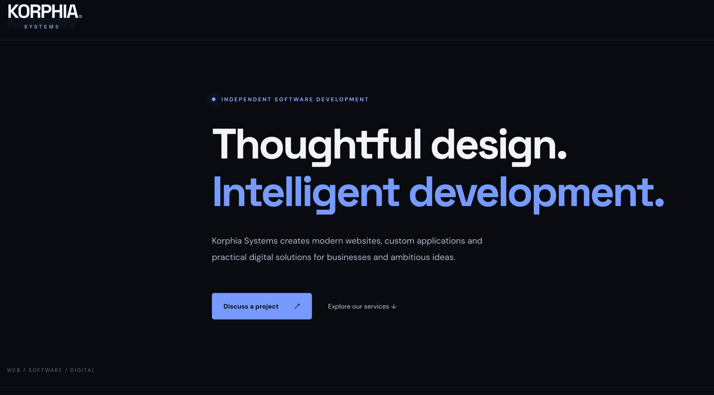
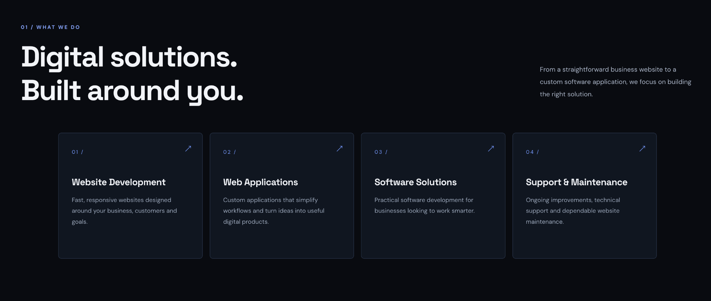
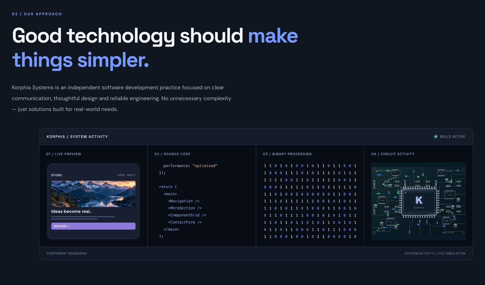

# Korphia Systems

### Thoughtful Design. Intelligent Development.

Independent software development, website design and practical digital solutions for businesses.

## Live Website

**https://www.korphia.com**

## Project Screenshots

### Desktop Homepage

### Digital Solutions

### Our Approach

---

## The Project

Korphia Systems is an independent software development practice focused on clear communication, thoughtful design and reliable engineering.

The website introduces the Korphia identity, services and development approach through a modern, responsive interface.

## Services

- Website Development
- Web Applications
- Software Solutions
- Support & Maintenance

## Design Approach

The website uses a dark visual identity, bold typography, blue accents and a structured layout.

Its design emphasises clarity, usability and a straightforward presentation of technical services.

## Source Code

The website's application source code is maintained in a separate private repository.

This public repository contains project information and approved screenshots.

---

## Developed By

**Al Hewitt — BuiltByAl**

Website design, software development and digital business systems.

**Korphia Systems** — intended trading identity.

[Website](https://www.korphia.com) | [GitHub Profile](https://github.com/BuiltByAl)
